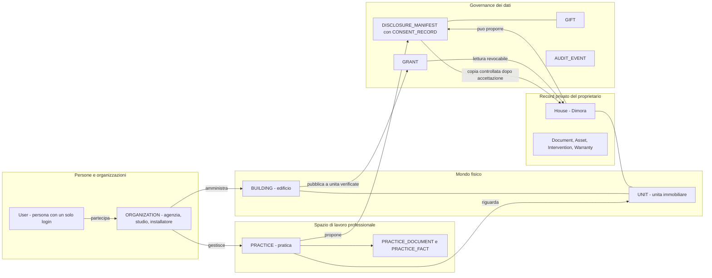
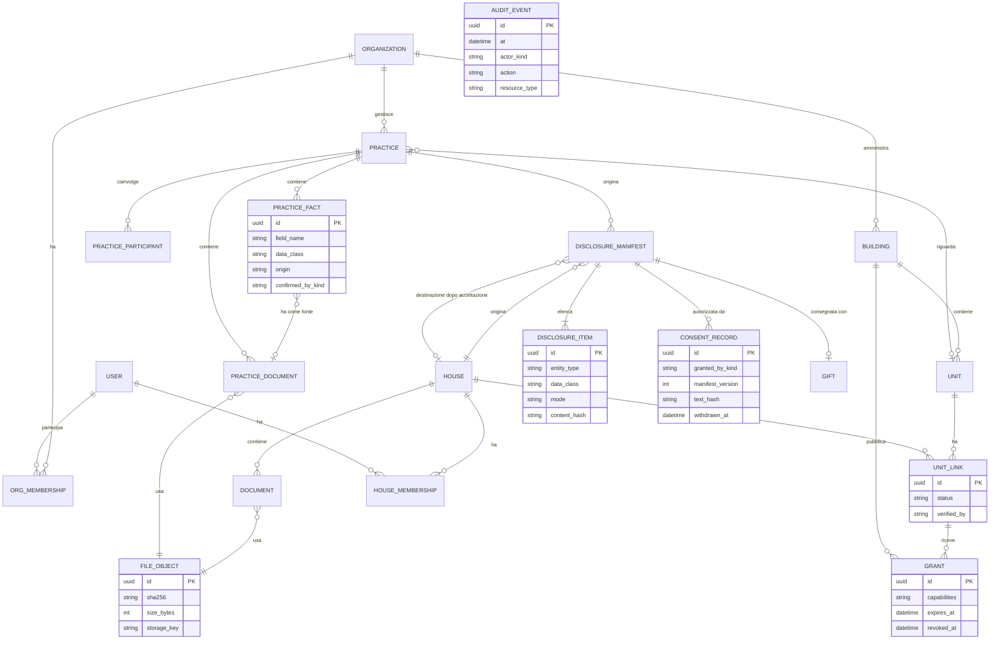
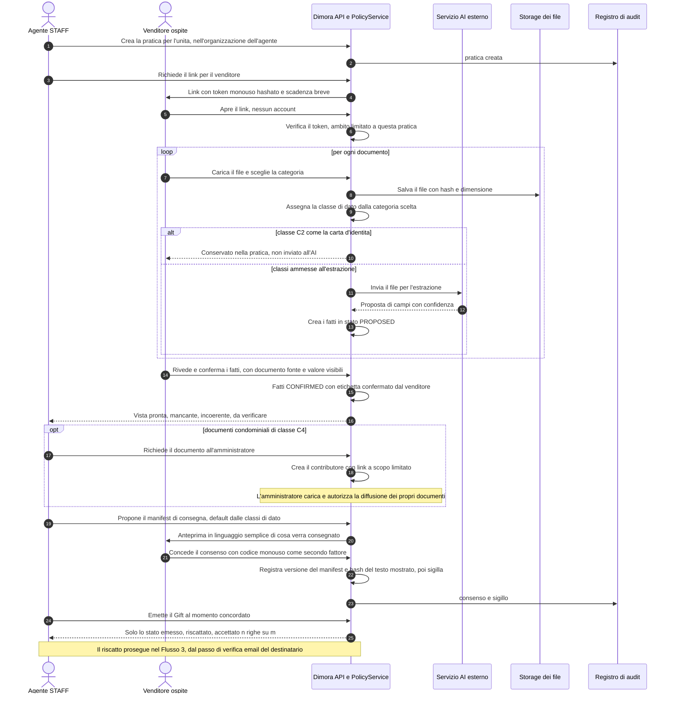
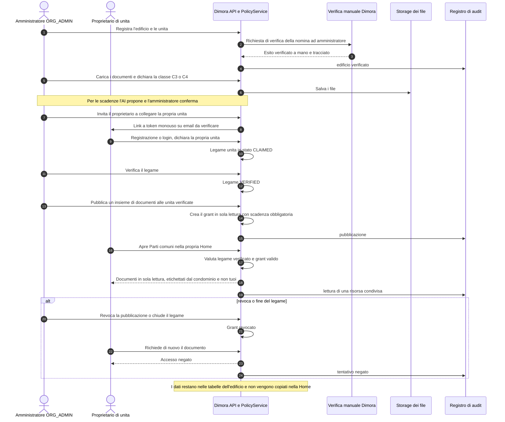
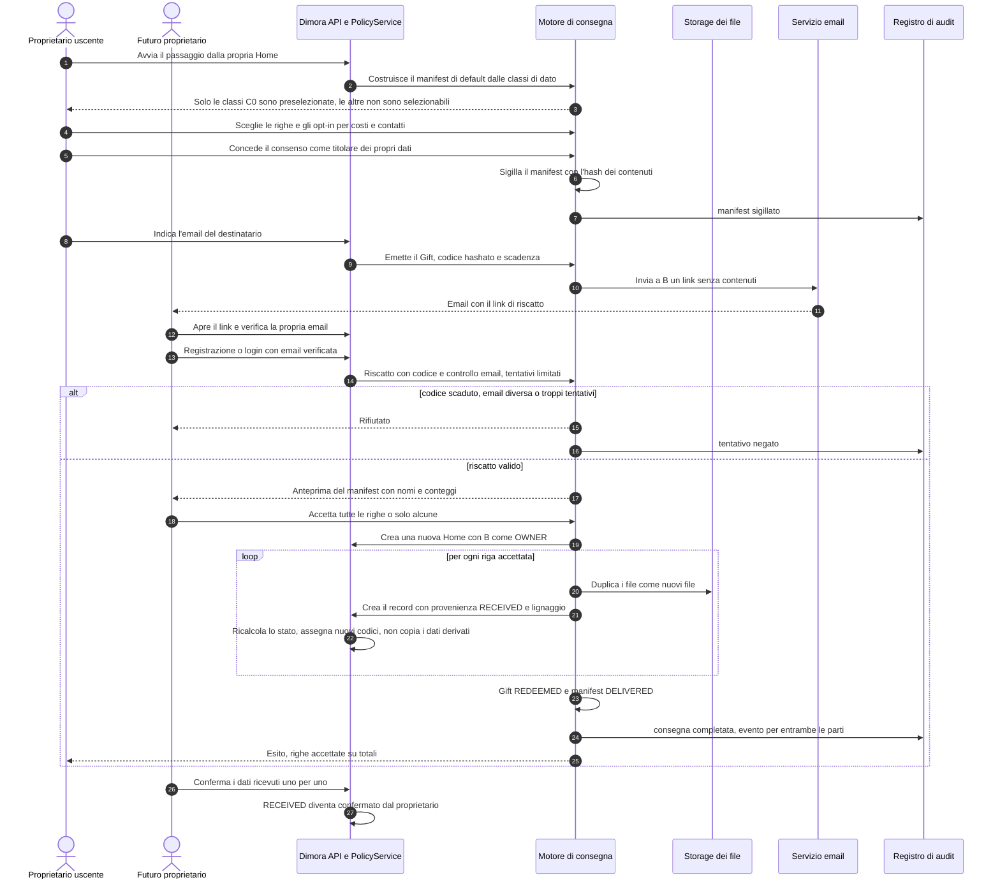

# Round 4 — Revisione tecnica dell'architettura: Dimora Partner + Home (Concept V3)

**Data:** 2026-10-12 · **Stato:** ricerca, ipotesi da validare · **Non modifica** codice, schema Prisma, backlog, roadmap, ADR né changelog.
**Ruolo del mandato:** Principal Software Architect di Dimora/HomeOS.
**Codice analizzato:** `Vincenzobrutto/Home_OS`, `main` @ `cdbb318`. **Contesto di ricerca:** branch `research/dimora-four-agent-intelligence-20261012` @ `3fbe679`. Il Round 3 (`claude/red-team-round3-partner-home-20261012`) è stato letto come input, non come autorità: dove lo riuso lo dico.
**Etichette** (da `RESEARCH_PROTOCOL.md`): **[V]** verificato *leggendo* il codice o i documenti, con riferimento (il codice non è stato eseguito) · **[I]** inferenza · **[S]** stima con ipotesi dichiarate · **[ND]** non determinato. **Stati funzionali** (da `PROJECT_CONTEXT.md`): implementata / disponibile in alpha / pianificata / ipotizzata / esclusa.

---

## 0. Risposta in breve

**In una frase.** Il codice di oggi è costruito attorno a un'idea sola: *una casa = un contenitore = un proprietario*. È la scelta giusta per l'alpha, ma il Concept V3 la rompe in quattro punti. Servono quattro separazioni che oggi non esistono: (1) la **pratica** di un professionista distinta dall'**immobile privato**; (2) le **organizzazioni** distinte dalle **persone**; (3) l'**edificio** distinto dalla **singola unità**; (4) il **possedere** un documento distinto dal **poterlo diffondere**.

1. **Cosa regge.** La pipeline "l'AI propone, l'utente conferma", la provenienza dei dati a due assi (origine / conferma), `Intervention` e `Warranty` come record canonici, l'isolamento tra case (verificato da un test e2e) e soprattutto **un'unica funzione di controllo accessi** richiamata in 35 punti di 14 file: è il punto di innesto per un nuovo modello di permessi [V].
2. **Cosa non regge per V3.** Ogni documento appartiene obbligatoriamente a una casa; i ruoli `OWNER/MEMBER/VIEWER` esistono ma **non vengono applicati** (conta solo "esiste una membership"); non c'è nessun registro di audit; non esistono organizzazioni; il file di un documento è un percorso su disco di un solo documento; la verifica dell'email non esiste [V, §2.2].
3. **Raccomandazione.** **Opzione B, "Partner Lite scalabile", costruita a incrementi** e solo dopo la validazione commerciale. L'opzione A (la pratica come "casa speciale") è la più veloce ma crea debito proprio dove il rischio è più alto (isolamento dei dati di terzi). L'opzione C (multi-organizzazione completa) è **NO GO ora**: è un lavoro da circa 2,5–3,5 anni-persona [S], insostenibile con un fondatore (ADR #77) e prematuro senza prove di mercato.
4. **Copia, non trasferimento.** Nel modello proposto non esiste mai l'operazione "cambia proprietario". Il futuro proprietario riceve una **nuova casa** con una **copia controllata** dei soli dati autorizzati, con provenienza "ricevuto, non verificato dal proprietario". Questo evita anche il problema del `House.ownerId` (§2.2, I4).
5. **Possesso ≠ diffusione.** Ogni documento ha un *luogo* (custodia: pratica, casa, edificio) e, **separatamente**, una *policy di diffusione* che per default è "nessuna". Averlo in archivio non autorizza a inoltrarlo (§4.5).
6. **Cosa costruire per primo (solo dopo validazione).** Le **fondamenta di fiducia** (autorizzazione per capability, audit, identificatori robusti, identità con token monouso, file separati dal documento) **insieme alla Pratica come aggregato separato**: è l'incremento **B1a**. La **consegna controllata** (B1b) viene subito dopo, **dietro due gate** (parere legale; evidenza di riscatto). Console amministratori, edificio, condivisioni: dopo ancora (§12).
7. **Due difetti già presenti nel codice** (fuori scope, non corretti): il codice casa `CASA-####` può collidere dopo la cancellazione di una casa, e questo è raggiungibile oggi dall'alpha dopo B53 (D1); i ruoli non sono applicati, quindi **non va invitato nessun secondo utente a una casa finché non è risolto** (D3) [V, §2.4].
8. **Stime [S]** (una persona esperta del codice, test e documenti inclusi, **esclusi** parere legale, design, supporto): **A ≈ 24–38 settimane-persona, B ≈ 59–91, C ≈ 123–186**. B1a+B1b ≈ 47–73. Incertezza ±50%, nessun dato di velocità del team nel repo (§10).

| Opzione | Verdetto architetturale | Motivo in una riga |
|---|---|---|
| **A** Minima estensione dell'alpha | **Solo demo con dati fittizi.** Mai con dati reali di terzi | Veloce e riusa quasi tutto, ma fonde pratica e immobile e lascia l'organizzazione implicita |
| **B** Partner Lite scalabile | **Destinazione raccomandata, a incrementi** | Isola per costruzione i dati di terzi, riusa la pipeline, resta sostenibile |
| **C** Multi-organizzazione completa | **NO GO ora** | Costo e complessità non giustificati da alcuna evidenza di domanda |

---

## 1. Metodo, fonti e limiti

**Letto per intero:** `AGENTS.md`, `README.md`, `docs/domain-model.md`, `docs/architecture.md`, `prompts/coding-guidelines.md`, `backend/prisma/schema.prisma` (1.198 righe, 35 modelli, 29 enum), le ADR rilevanti in `docs/decisions.md` (#6, #32, #34, #37, #46, #53–55, #67, #73, #77), le voci di backlog B10, B12, B39, B45, B51, `docs/mvp-v1.md` §7–8. **Letti nel codice:** `access-control.service.ts`, `auth.service.ts`, `auth.controller.ts`, `main.ts`, `houses.service.ts`, `documents.controller.ts`, `documents.service.ts` (upload, remove, getFile, moveToHouse, codici, accesso), `file-storage.service.ts`, `interventions.service.ts` (validazione riferimenti), `assets.service.ts` e `rooms.service.ts` (generazione codici), `claude-extraction.service.ts` (cosa viene inviato all'AI), `frontend/src/App.tsx` e `config.ts`. **Letti per contesto:** `PROJECT_CONTEXT.md`, `RESEARCH_PROTOCOL.md`, la tesi di canale, i one-pager, la review di Gemini e l'intake di Copilot sul branch di ricerca; il report del Round 3.

**Non fatto:** nessuna esecuzione di codice, test o build; nessuna ispezione di un database reale; nessun penetration test; nessuna valutazione legale (GDPR, ruoli titolare/responsabile, condominio: **[ND]**, serve un professionista); i fatti di mercato su concorrenti sono quelli del Round 3, non riverificati qui. Le stime di sforzo sono **mie**, non derivate dalla velocità del team (nel repo non c'è un dato di velocità).

**Assenze verificate [V]:** nello schema (35 modelli) e in `backend/src` non esistono `Organization`, `Practice`, `Building`/`Unit`, condivisione, invito, Gift, audit log, invio email, coda di lavori, object storage. `docs/domain-model.md:153` dice esplicitamente che il trasferimento della casa non è implementato.

---

## 2. Assessment dell'architettura attuale

### 2.1 Fotografia

| Aspetto | Stato | Evidenza |
|---|---|---|
| Stack | NestJS 11 + Prisma 6.19.3 + PostgreSQL; React 19 + Vite, nessun router | `docs/architecture.md` §2 |
| Dimensione del modello | 35 modelli, 29 enum, 22 migrazioni (tutte additive) | `schema.prisma`; `ls backend/prisma/migrations` [V] |
| Modelli con `houseId` diretto | 17 (Asset, Contact, Document, Floor, HouseFieldProvenance, HouseMembership, HouseTimelineEvent, Intervention, Issue, MaintenancePlan, PlantResponsibility, Recommendation, Room, ScanSession, ScoreSnapshot, ThermalSystem, UtilityBill) | `schema.prisma`; coerente con `decisions.md` #53 [V] |
| Controllo accessi | `assertHouseAccess`: **35 chiamate in 14 file** di servizio. `assertHouseOwner`: **1 sola chiamata** (`houses.service.ts:82`, cancellazione casa) | grep su `backend/src` [V] |
| Test | Jest backend; **un solo** test e2e di isolamento tra case (`test/main-flow.e2e-spec.ts:162`); nessun test frontend | [V] |
| Archiviazione file | Disco locale `uploads/`, percorso salvato in `Document.fileUrl` | `file-storage.service.ts:13-25`; `schema.prisma:611` [V] |
| Infrastruttura | Nessuna dipendenza per email, code, object storage; **nessun deploy pubblico** | `backend/package.json` [V]; `docs/HANDOFF.md:7` |

### 2.2 Le dieci invarianti strutturali che V3 deve rompere o aggirare

Sono il cuore dell'assessment: non sono "bug", sono **scelte coerenti con l'alpha** (spesso documentate in ADR) che smettono di valere con partner e organizzazioni.

| ID | Cosa è oggi | Evidenza [V] | Perché blocca V3 |
|---|---|---|---|
| **I1** | La casa è l'unico contenitore **e** l'unico confine di isolamento | `Document.houseId` obbligatorio (`schema.prisma:609`); 17 modelli con `houseId` | Una pratica professionale non può esistere fuori da una `House`: forzarla crea un "falso immobile" su cui girano Genesis, Home Score, Detective, export e cancellazione |
| **I2** | Ogni riferimento incrociato verifica "stessa casa" | `interventions.service.ts:283-298` e `324-330`; `assets.service.ts:44-52` | Un bene delle parti comuni non può essere collegato a interventi di più unità: serve un livello sopra la casa (edificio) o una proiezione |
| **I3** | L'autorizzazione è "esiste una membership", non "cosa puoi fare" | `access-control.service.ts:30-37` (nessun ruolo letto); il ruolo è letto solo in `:44-53` | Con B12, un `VIEWER` avrebbe gli stessi poteri di scrittura e **di export** di un `OWNER`. Non esistono ruoli professionali |
| **I4** | `House.ownerId` è obbligatorio e `deleteAccount` cancella le case **per `ownerId`**, non per ruolo | `schema.prisma:334`; `auth.service.ts:159-175` | Se un professionista preparasse la casa di un cliente, la sua uscita cancellerebbe dati altrui. Si evita solo se la casa nasce sempre del proprietario vero (**copia, non trasferimento**) |
| **I5** | Il file è un percorso su disco di **un solo** documento; la cancellazione sposta il file senza controllare altri riferimenti | `file-storage.service.ts:43-76`; nessun contatore di riferimenti | Una copia che condividesse il percorso verrebbe distrutta dalla cancellazione dell'originale: la consegna deve **duplicare i byte** (o introdurre un contatore) |
| **I6** | La provenienza è "un record per campo, sovrascritto"; il documento sorgente è `onDelete: SetNull` | `schema.prisma:585-602`, `416-430`; `domain-model.md:149` | Cancellando il documento sorgente si perde la fonte; non esiste "ricevuto da"; nessuna storia delle versioni |
| **I7** | Nessun audit: solo `Intervention.createdByUserId` | `schema.prisma:959`; `interventions.service.ts:65`; `houses.service.ts:96-100` (export consentito a ogni membro) | Impossibile rispondere a "chi ha visto, esportato, condiviso cosa", requisito base di B39 e B51 |
| **I8** | Identità minima: nessuna verifica email né reset, nessun rate limiting; token di sessione = chiave primaria in chiaro; CORS riflette qualunque origine con credenziali | `auth.service.ts:59-69`; `schema.prisma:284-286`; `main.ts:14` (il commento dichiara l'uso solo dev) | Ogni flusso di invito che crei utenti "vuoti" è un varco (vedi D4); i link per venditori e destinatari richiedono token monouso |
| **I9** | Il file intero va a un servizio AI di terze parti con **un solo consenso per utente** | `claude-extraction.service.ts:268-294`; `User.consentedAt` | I documenti di terzi (es. carta d'identità del venditore) non devono entrare nella pipeline senza classificazione e base giuridica **[ND legale]** |
| **I10** | Il frontend carica sempre la prima casa e "nasconde" le funzioni con un flag **lato client** mentre il backend le espone tutte | `App.tsx:118-140`; `config.ts:10` | Nessun contesto multi-casa o multi-ruolo; nascondere una funzione non equivale ad autorizzarla |

### 2.3 Verifica entità per entità

"Consegna" indica se i dati possono essere **copiati** a un nuovo proprietario (classi di dato in §4.5). *Mai* = non passa in nessun caso; *scelta* = solo per decisione esplicita.

| Entità | Ruolo oggi | Adeguatezza a V3 | Gap | Consegna (copia) |
|---|---|---|---|---|
| `User`, `Session` | Persona e login | Buona come identità unica | Nessuna verifica email; sessione non hashata (I8) | Mai |
| `House` | Immobile **e** record privato **e** confine di tenancy | Va bene come "Dimora privata" | Fonde tre concetti; `ownerId` (I4) | Campi del profilo: *scelta*, per campo |
| `HouseMembership` | Accesso per casa, ruoli `OWNER/MEMBER/VIEWER` | Struttura giusta | Ruolo non applicato (I3); nessuna scadenza, nessun invitante | Mai |
| `Room`, `Floor` | Geometria e piani | Riusabili | Nessuna; codice globale (D2) | *Scelta* (planimetria) |
| `Asset` (+ campi liberi) | Centro del sistema | Riusabile | `code` globale (D2); nessun legame a un bene condominiale | *Scelta*; `code` rigenerato, `status` ricalcolato |
| `Document` | File di una casa | Pipeline riusabile | `houseId` obbligatorio (I1); `fileUrl` un-a-uno (I5); nessuna versione, nessuna classe di dato | *Scelta* per classe (C0 sì, C1 solo i fatti, C2-C3 mai) |
| `AssetFieldProvenance`, `HouseFieldProvenance`, `AssetCustomField` | Provenienza a due assi | **Ottimo punto di partenza** (ADR #34) | Nessun "ricevuto da"; nessuna storia (I6) | Non copiata: si genera nuova provenienza `RECEIVED` |
| `Intervention` (+ link a Asset/Documenti) | Fatto tecnico canonico | Riusabile: è il payload più prezioso | Costo e `contactId` sono dati personali/di terzi | *Scelta*; costo e contatto: **opt-in** |
| `Warranty` | Garanzia ripetibile | Riusabile | Nessuna | *Scelta* (scadenza, tipo, fornitore, prova) |
| `Contact` | Rubrica della casa | Per casa, non condivisibile | Dati di terzi (telefono, note) | Default **no**, opt-in per contatto |
| `MaintenancePlan`, `MaintenanceOccurrence` | Piani e storico | Riusabili | Un piano è una decisione del vecchio proprietario | Piani: **no** (si rigenerano); storico come `Intervention` |
| `ThermalSystem`, `PlantBooklet`, `EfficiencyControlReport` | Impianto termico | Riusabile | Codici libretto cifrati ancora senza servizio di cifratura (B45) | Impianto e controlli: *scelta*; **codici cifrati mai** (`schema.prisma:807-809`) |
| `PlantResponsibility` | Responsabilità dichiarata | Riusabile | Dato personale del responsabile | Mai |
| `UtilityBill` | Consumi elettrici | Riusabile in Home | Dato personale di consumo | Mai |
| `Issue`, `Recommendation`, `ScoreSnapshot`, `HouseTimelineEvent`, `AssetTimelineEvent` | Derivati e cronologia | Riusabili | `Issue` ha riferimenti "morbidi" senza chiave esterna (`schema.prisma:1098-1102`): si spezzano con copie e cancellazioni | **Mai**: si ricalcolano nella nuova casa |
| `GmailConnection`, `DriveConnection` | Token OAuth in chiaro, uno per utente | Non adatte a org | B10; un solo account per utente | Mai |
| `RegulatoryTerritory`, `RegulatoryRule` | Dati di sistema versionati | Riusabili anche a livello edificio | Nessuna | Non per-casa |

### 2.4 Difetti e rischi trovati leggendo il codice (fuori scope: **non corretti**, non ho toccato il backlog)

`AGENTS.md` chiede di tracciare ciò che si scopre fuori scope; il mandato mi vieta di modificare il backlog. Li elenco qui, la decisione se e dove tracciarli è tua.

| ID | Difetto | Dove | Raggiungibile oggi? | Gravità |
|---|---|---|---|---|
| **D1** | Il codice casa è `CASA-` + (numero di case esistenti + 1). Se una casa viene cancellata, la creazione successiva può rigenerare un codice già usato e fallire per il vincolo di unicità. Esempio: case 0001, 0002, 0003; cancello 0001; la prossima ottiene 0003 | `houses.service.ts:31-32`; `House.code @unique` (`schema.prisma:342`) | **Sì**, dalla cancellazione introdotta da B53 (2026-09-04) con una coorte alpha che può cancellare account [I] | Media: blocca la creazione di nuove case |
| **D2** | `AST-###`/`AMB-###` = massimo codice **ordinato come testo** + 1. Da `AST-1000` in poi `AST-999` risulta "maggiore" e il successivo è sempre `AST-1000`, già esistente: ogni creazione fallisce. Due richieste simultanee calcolano lo stesso codice (nessun ritentativo) | `assets.service.ts:85-91`; `rooms.service.ts:28-34`; `documents.service.ts:1438-1445` | Non con 15-20 tester [I]; **sì con volumi da partner**. ADR #6 lo accetta perché "case singole, non migliaia di asset": V3 smentisce quell'ipotesi | Alta con partner |
| **D3** | I ruoli non sono applicati: ogni membro può fare tutto tranne cancellare la casa | `access-control.service.ts:30-37`; 35 chiamate senza ruolo | Non sfruttabile oggi (nessun invito esiste, B12) | **Bloccante per B12**: non invitare nessuno prima di risolverlo |
| **D4** | `setPassword` consente a chiunque conosca un'email di impostare la password di un account che non ne ha una | `auth.service.ts:118-136`; `User.passwordHash` nullable (`schema.prisma:249`) | Solo account pre-B2 senza password [I] | Alta come **vincolo di progetto**: nessun flusso di invito deve creare utenti senza password |
| **D5** | Upload: controllo solo sul `Content-Type` dichiarato (nessun controllo dei byte, nessun antimalware) | `documents.controller.ts:40-49`; ADR #56 | Sì, ma accettato per l'alpha | Media con file di terzi (venditori, amministratori) |

### 2.5 Punti di forza riusabili

- **Un'unica porta per i permessi.** `AccessControlService` è già il punto unico: sostituirlo con una facciata a capability tocca una classe e 35 chiamate, non l'architettura [V].
- **"L'AI propone, l'utente conferma"** è già strutturale (`analyze` e `confirm` separati, `documents.controller.ts:122-172`): è il vincolo giusto anche per le pratiche.
- **Provenienza a due assi** (origine del valore / fatto di conferma, ADR #34) e `EvidenceStatus`: base corretta per distinguere "dichiarato", "estratto", "ricevuto", "attestato".
- **`Intervention` canonico multi-Asset** (ADR #46) e `Warranty` unico writer (ADR #47): sono il payload tecnico da consegnare.
- **`FileStorageService` centralizzato** (B61): è il punto in cui sostituire il disco con un object storage senza toccare i servizi.
- **Export ZIP** (`houses.service.ts:96-197`): seme del "pacchetto di consegna", ma oggi esporta tutto a qualunque membro, incluse spese e contatti di terzi: va **filtrato**, non riusato così com'è.
- **Gerarchia territoriale versionata** (`RegulatoryTerritory`): già adatta a regole a livello edificio.
- **ADR #73** ("il modello dati deve restare compatibile con una consegna mediata da un professionista") è già un vincolo scritto: questo documento ne è l'attuazione, senza anticipare codice.

---

## 3. Principi di progetto

Sono i vincoli che uso per giudicare le tre opzioni. Cinque sono già nel repository (indicati); gli altri sono la traduzione architetturale del mandato.

| # | Principio | Origine |
|---|---|---|
| P1 | **Quattro separazioni:** soggetto del record (persone/organizzazioni), spazio di lavoro (pratica), mondo fisico (edificio/unità), governance dei dati (consenso, accessi, audit) | Mandato Round 4 |
| P2 | **Isolamento per costruzione, non solo per filtro.** I dati di terzi vivono in tabelle diverse da quelle della Home, così un errore in una query `where` non può mescolarli | Difesa in profondità [I] |
| P3 | **Copia, non trasferimento.** Nessuna operazione cambia il proprietario di un record: la consegna crea record nuovi nel contesto del destinatario | Round 3 §4.4, T1; mandato |
| P4 | **Custodia ≠ autorità di diffusione.** Avere un documento non autorizza a inoltrarlo; la policy di diffusione è un dato a parte, con default "nessuna" | Mandato |
| P5 | **Separazione dei compiti:** chi carica ≠ chi conferma ≠ chi autorizza la diffusione ≠ chi riceve | Round 3 §4.4 |
| P6 | **L'AI propone, un umano conferma** anche per i dati *ricevuti*: una copia non è verificata finché il destinatario non la conferma | `coding-guidelines.md` punto 1; Round 3 T5 |
| P7 | **Ogni astrazione nuova ha almeno due consumatori già oggi.** Giustificate: `FileObject` (Document e PracticeDocument), motore di consegna (Pratica→Casa e Casa→Casa), facciata dei permessi (35 chiamate), `AuditEvent` (tutto). Non introduco `Practice.kind` multivalore né un motore generico di workflow | `coding-guidelines.md` "Cosa evitare" |
| P8 | **Additivo e reversibile:** solo nuove tabelle e colonne nullabili; nessuna migrazione distruttiva dei dati della Home; funzioni dietro un flag **lato server** | 22 migrazioni additive già in repo [V]; I10 |
| P9 | **Nessun claim di certificazione:** le viste dicono *presente / mancante / da verificare / ricevuto*, mai *conforme* | `PROJECT_CONTEXT.md`; Round 3 T4 |

---

## 4. Domain model concettuale proposto

> Convenzione: **nome in maiuscolo** = entità nuova proposta; `nome in codice` = entità esistente nello schema. Nessuna di queste entità esiste oggi. Questo è un modello **concettuale**: non è uno schema Prisma e non lo anticipa.

### 4.1 Le quattro zone e le loro relazioni

`AUDIT_EVENT` non ha relazioni disegnate di proposito: è **append-only** e cita le risorse per identificativo, così sopravvive alla loro cancellazione (diversamente da `AssetFieldProvenance`, I6).

### 4.2 Pratica professionale distinta dall'immobile privato

**Cos'è.** La **PRACTICE** è l'unità di lavoro di un professionista (oggi: la "pratica pronta" dell'agenzia, Config 1 del Round 3). Appartiene a una **ORGANIZATION**, non a una persona: se l'agente lascia l'agenzia, la pratica resta all'agenzia.

**Cosa contiene.**
- **PRACTICE_DOCUMENT**: i file raccolti (dal venditore, dall'agenzia, dall'amministratore), ciascuno con `dataClass` (§4.5) e un **FILE_OBJECT**.
- **PRACTICE_FACT**: i dati estratti e confermati (es. classe energetica, anno della caldaia), con origine, documento fonte e chi ha confermato (venditore, agente, contributore). È l'equivalente pratica di `Asset` + provenienza, ma **non è un `Asset`**: non entra in nessuna logica della Home (Genesis, Home Score, Detective).
- **PRACTICE_PARTICIPANT**: le parti coinvolte *senza account* (venditore, amministratore, tecnico) con un link a token monouso, scadenza e ambito limitato a questa pratica.
- La vista **pronta / mancante / incoerente / da verificare** è una **funzione** dei fatti rispetto a una checklist. La checklist è un **dato di configurazione versionato** (stesso principio delle `RegulatoryRule`, ADR #41), non codice.

**Perché tabelle separate dalla Home (P2).** La strada alternativa è un `scopeType/scopeId` generico su `Document`: Prisma non ha chiavi esterne polimorfiche, quindi si perderebbero cascata e integrità, e **tutte** le query sui 17 modelli con `houseId` andrebbero riviste. Con tabelle distinte, il codice della Home *non può* leggere un documento della pratica: l'isolamento è una proprietà dello schema, non della disciplina di chi scrive le query.

**Stati.** `OPEN → CLOSED → ARCHIVED → PURGED`. Lo stato della consegna vive nel manifest (§4.7), non nella pratica: una pratica può restare aperta dopo una consegna parziale.

**Variante: il venditore è già utente Dimora.** La sua Home diventa *sorgente* di una consegna verso la pratica (stesso motore, §4.7). Non esiste mai un accesso ambientale dell'agenzia alla Home del venditore.

### 4.3 Organizzazioni e utenti

| Concetto | Modello proposto | Nota |
|---|---|---|
| Persona | `User` invariato: **un login, molti contesti** (la stessa persona può essere agente e proprietario) | Evita account duplicati |
| Organizzazione | **ORGANIZATION** (`kind`: agenzia, studio di amministrazione, installatore; ragione sociale, P.IVA) | La P.IVA è dato d'impresa, non personale [I] |
| Appartenenza | **ORG_MEMBERSHIP** (utente, organizzazione, ruolo `ORG_ADMIN` o `STAFF`, stato, invitante, scadenza) | Rimuoverla revoca subito l'accesso alle pratiche dell'org |
| Parti esterne | **PRACTICE_PARTICIPANT** (non è un `User`): venditore, contributore (amministratore, tecnico) | Niente utenti "vuoti": evita D4 |
| Promozione a utente | Un partecipante diventa `User` solo con email **verificata** e password propria | Mai un account creato "al posto di" qualcuno |
| Collaborazione tra organizzazioni | **Fuori da B**: un amministratore contribuisce a una pratica solo come partecipante con link. Visibilità incrociata tra org = Opzione C | Riduce l'area d'attacco |

Requisiti d'identità (WP5): verifica email, reset password, token monouso **hashati** (anche le sessioni), rate limiting, restrizione CORS, CSRF per l'interfaccia partner. Oggi nulla di questo esiste (I8).

### 4.4 Edificio, condominio, parti comuni, singole unità

- **BUILDING**: indirizzo, riferimenti catastali, codice ISTAT del comune, amministratore opzionale (una ORGANIZATION). Può esistere **senza** amministratore su Dimora: lo crea la prima pratica o il primo proprietario che lo dichiara.
- **UNIT**: l'unità immobiliare (sub catastale, interno, piano). È l'**àncora fisica che sopravvive ai cambi di proprietà**: la Home del venditore e quella dell'acquirente puntano alla stessa unità in tempi diversi. La `House` resta il *record privato*; non viene rinominata.
- **UNIT_LINK** (Home ↔ Unità): stato `CLAIMED → VERIFIED | REJECTED`, con chi ha verificato. **Solo i legami `VERIFIED` possono ricevere pubblicazioni dell'edificio**; altrimenti dichiarare "abito nell'interno 5" diventerebbe una via d'accesso ai documenti condominiali (controllo d'accesso per autodichiarazione). La verifica avviene via invito dell'amministratore o dal contesto di una pratica.
- **Parti comuni, perché serve un livello sopra la casa.** I2 impedisce a un bene di essere collegato a interventi di più case. Due strade:
  - **Opzione B (consigliata):** nessun "bene comune" strutturato. L'amministratore pubblica **documenti e scadenze** dell'edificio; ogni unità verificata li vede in sola lettura tramite un **GRANT**, etichettati "dal condominio, non tuoi". I dati restano nelle tabelle dell'edificio, **non vengono copiati** nelle tabelle della Home.
  - **Opzione C:** `CommonAsset` e interventi a livello edificio, proiettati sulle unità. Il precedente tecnico esiste: `MaintenancePlan` ha già un vincolo XOR tra soggetti alternativi, scritto a mano in SQL perché Prisma non sa esprimere i `CHECK` (`migrations/20260903120000_add_compliance_foundations/migration.sql:153`, ADR #42); lo stesso schema è riusabile per `ThermalSystem` a livello edificio.
- **"Parti comuni" nella Home senza amministratore sulla piattaforma.** Il proprietario può caricare, per esempio, il regolamento ricevuto per email: resta nella sua Home, classificato C3/C4, **non diffondibile** a terzi oltre ciò che la policy consente (§4.5). È il caso concreto di *possesso senza autorizzazione alla diffusione*.
- **Fuori perimetro:** millesimi, assemblee, contabilità, ticket (Domustudio/Multidomus li coprono; Round 3 H8, H11).

### 4.5 Documenti da fonti diverse: custodia contro diffusione

**Fonte del file** (estensione additiva di `DocumentSource`, oggi `UPLOAD | GMAIL | DRIVE`): `OWNER_UPLOAD`, `GMAIL`, `DRIVE`, `SELLER_UPLOAD`, `AGENCY_UPLOAD`, `ADMIN_PROVIDED`, `TECHNICIAN_PROVIDED`, `RECEIVED_VIA_DISCLOSURE`.

**Due attributi indipendenti su ogni documento e fatto:**
1. **Custodia**: dove vive (pratica, casa, edificio).
2. **Policy di diffusione**: classe di dato, **chi ha l'autorità** di autorizzarla, finalità consentita, destinatari ammessi. **Default: nessuna diffusione.**

**Classi di dato** (allineate alla tabella di Round 3 §4.4; il confine legale è **[ND]**, da validare con un professionista):

| Classe | Esempi | Passa alla Home di un nuovo proprietario? | Autorità di diffusione |
|---|---|---|---|
| **C0** Dato tecnico dell'immobile | Classe energetica e scadenza APE, impianti (tipo, anno, marca, modello), dati catastali non nominativi, planimetria, garanzie su beni | **Sì, dopo scelta esplicita** | Il cedente (venditore/proprietario) |
| **C1** Documento con dati di terzi | Atto di provenienza, visure con nominativi, ipoteche e mutui | **Il documento no**; passano solo i fatti C0 estratti, con provenienza | Il cedente, per i soli fatti C0 |
| **C2** Dato personale del cedente o dell'acquirente | Identità, codice fiscale, antiriciclaggio, mandato, provvigione, proposte, dati del mutuo | **Mai**: resta nella pratica | Nessuna (non diffondibile) |
| **C3** Dato condominiale di terzi | Verbali con altri condòmini, morosità, elenco condòmini | **Mai** nella Home | Solo l'organizzazione titolare |
| **C4** Documento condominiale d'uso limitato | Regolamento, tabelle millesimali, attestazione su spese/lavori/liti per l'unità | **Solo con autorizzazione dell'amministratore**, per finalità dichiarata [ND legale] | L'amministratore |
| **C5** Dato derivato | `Issue`, `ScoreSnapshot`, cronologia | **Mai**: si ricalcola nella nuova casa | — |

**Regole.**
- Un documento eredita la classe **più restrittiva** del suo contenuto. Un documento **non classificato** vale C2 finché qualcuno non lo classifica.
- **La classe la propone l'AI e la conferma un umano** (P6). Ma la classificazione deve avvenire **prima** dell'invio all'AI (I9): l'interfaccia di caricamento chiede la categoria ("carta d'identità", "libretto caldaia"...) e i documenti C2 **non entrano** nell'estrazione senza base giuridica **[ND]**. Non ci si affida all'AI per decidere cosa mandare all'AI.
- Il possesso non cambia la classe: un documento C4 caricato dal proprietario resta C4.

### 4.6 Diritti di accesso e revoca

L'accesso nasce da **tre fonti**, valutate da una sola facciata (`PolicyService`, che sostituisce internamente `assertHouseAccess` mantenendone la firma durante la migrazione, §8):
1. **Appartenenza:** `HouseMembership`, `ORG_MEMBERSHIP`, `PRACTICE_PARTICIPANT`.
2. **Capability del ruolo** (§5), nominate `dominio.azione`, per esempio `house.export`, `practice.disclosure.authorize`.
3. **GRANT esplicito:** a un insieme di elementi, con capability (`READ`, `DOWNLOAD`), **scadenza obbligatoria**, finalità, chi lo ha creato.

Principi: **negato per default**; nessun accesso ambientale del personale Dimora (solo *break-glass*: motivato, a tempo, tracciato; notifica al titolare dove lecito **[ND]**).

**Cosa significa "revoca"**, detto senza promesse false:

| Oggetto revocato | Effetto | Limite |
|---|---|---|
| Appartenenza a org o pratica | Immediato: la facciata nega alla richiesta successiva | Le sessioni restano valide, ma non autorizzano nulla |
| `GRANT` di lettura | Immediato per le richieste successive | Ciò che il destinatario ha già scaricato **non è richiamabile** |
| Consegna **non ancora riscattata** | Il Gift decade, il manifest passa a `REVOKED` | — |
| Consegna **già eseguita** (copia) | **Nessun richiamo**: il destinatario è titolare della propria copia | Ritiro del consenso dopo la consegna: processo manuale e tracciato **[ND legale]** |

La riduzione del danno non sta nel "ritirare", ma nel **non consegnare**: da qui la copia minima (§4.7) e il consenso prima, non dopo.

### 4.7 Condivisione selettiva e copia al nuovo proprietario

**DISCLOSURE_MANIFEST**: elenco **versionato e sigillato** di *cosa* viene consegnato, a partire da una sorgente (pratica **oppure** casa).
- **DISCLOSURE_ITEM**: tipo di entità, identificativo, modalità (`COPY_RECORD`, `COPY_FILE`, `FACTS_ONLY`), classe di dato, flag opt-in (costo, contatto), **hash del contenuto** al momento del sigillo.
- **CONSENT_RECORD**: chi ha autorizzato (il cedente, il proprietario, l'amministratore per i C4), **versione del manifest**, **hash del testo mostrato**, canale, ritiro. Per il caso agenzia il consenso va chiesto **all'incarico** (il venditore non ha più incentivo dopo il rogito, Round 3 §4.4) e **riconfermato** alla consegna; il motore deve supportare due consensi sullo stesso manifest, **quale basti è [ND legale]**.
- Un manifest sigillato è **immutabile**: ogni modifica è una nuova versione che richiede un nuovo consenso.

**Regole di copia** (il "come" del P3):
1. Si creano **record nuovi** nella Home del destinatario: nuovi identificativi, nuovi `code` (non quelli della pratica), `status` ricalcolato.
2. La provenienza dei campi copiati è `RECEIVED` con riferimento alla riga del manifest; il campo "confermato da" resta **vuoto** finché il destinatario non conferma (§4.9).
3. I file vengono **duplicati** come nuovi `FILE_OBJECT` (I5): la cancellazione dell'originale non tocca la copia e viceversa.
4. Mai copiati: classi C2, C3, C5; codici cifrati del libretto; token; contatti e costi senza opt-in (§2.3).
5. **Idempotenza**: ogni riga del manifest si copia una sola volta; un ritentativo non duplica.
6. **Atomicità per riga** con compensazione dei file (stesso principio della cancellazione a staging di B61, applicato alla creazione).
7. **Nessun canale di ritorno**: la pratica sa solo "consegnata / accettata n righe su m", non vede cosa il proprietario fa dopo.
8. Il destinatario può **rifiutare singole righe** prima dell'accettazione e cancellare dopo.

**Lo stesso motore serve due sorgenti** (P7): Pratica→Casa (agenzia, installatore) e Casa→Casa (il proprietario uscente verso il futuro proprietario). Il flusso 3 (§6) è la seconda.

### 4.8 Gift e attivazione del proprietario

- **GIFT**: `ISSUED → REDEEMED | EXPIRED | REVOKED`. Il codice è salvato **hashato**, è monouso, scade, ha un limite di tentativi.
- **Legame al destinatario.** Default: il codice si riscatta solo dopo aver **verificato l'email**; un codice "al portatore" senza verifica è escluso (si inoltra, si intercetta). Se l'email del destinatario non è nota all'emissione, si associa al riscatto, ma l'identità resta verificata [I].
- **Prima del riscatto il destinatario non è un `User` e non vede contenuti**: solo una pagina con il nome dell'ente e il numero di righe.
- **Attivazione:** riscatto → registrazione/login con email verificata → anteprima del manifest → accettazione per riga → creazione di una **nuova `House`** (`ownerId` = destinatario, membership `OWNER`) → copia → evento in cronologia "Ricevuto da [ente]" **solo se** il marchio è stato consentito.
- **Quattro stati commerciali distinti** (Round 3 §4.3), derivabili da eventi diversi e da non fondere: *venduto* (evento di fatturazione della pratica), *riscattato* (`GIFT.REDEEMED`), *attivo* (primo documento confermato entro 30 giorni, calcolabile da `Document` e provenienza), *rinnovato* (pagamento a 12 mesi, fuori da questo documento).
- Il periodo Premium eventualmente collegato al Gift è un **diritto (entitlement)** separato, **fuori scope** qui.

### 4.9 Provenienza, versionamento e audit

**Provenienza v2** (estensione additiva dell'ADR #34, che resta valido):
- Asse **origine**: `DECLARED`, `EXTRACTED`, `ATTESTED` (esistenti) **+ `RECEIVED`**.
- Asse **conferma** (`confirmedByUserId/At`): invariato; per i valori `RECEIVED` è vuoto finché il destinatario non conferma.
- **Lignaggio**: riferimento alla riga del manifest di provenienza e all'ente emittente; sopravvive alla cancellazione del documento sorgente (oggi `SetNull`, I6).
- Vocabolario di verifica visibile: *ricevuto, non verificato* → *confermato dal proprietario* → *attestato da terzi* (quest'ultimo oggi non raggiungibile da nessun flusso, `domain-model.md:148`).
- **Storia dei valori**: tabella append-only di revisioni (`FieldRevision`: entità, campo, valore, origine, attore, istante, motivo) per i campi che contano; le tabelle di provenienza attuali restano il "valore corrente". Non si unifica nulla ora.

**Versionamento dei documenti**: una `DocumentVersion` (documento, `FILE_OBJECT`, versione precedente, autore, motivo). Il file non si modifica mai; una nuova versione è un nuovo `FILE_OBJECT`. L'hash dei contenuti è ciò che si sigilla nel manifest.

**Audit** (`AUDIT_EVENT`, append-only): `at`, tipo di attore (`USER`, `PARTICIPANT_LINK`, `SYSTEM`, `SUPPORT`), identificativo, organizzazione, **azione**, tipo e id della risorsa, ambito, finalità, metadati **senza contenuti personali** (si registrano id e classi, non i dati). Eventi minimi: accesso e cambi di ruolo, creazione e revoca di grant, ciclo di vita del manifest (proposto, consentito, sigillato, emesso, riscattato, accettato, revocato), export, cancellazioni, accessi break-glass, **letture di risorse condivise**, richieste negate. Concatenazione degli hash per rendere evidente la manomissione: **Opzione C**, non B. **Conservazione e cancellazione dei log: [ND legale]**, perché un audit con dati personali ha a sua volta una base giuridica e un termine.

---

## 5. Matrice dei permessi per ruolo

### 5.1 Ruoli

| Ruolo | Chi è | Come ottiene l'accesso | Esiste oggi? |
|---|---|---|---|
| **OWNER** | Proprietario della Home | `HouseMembership` | Sì, ma è l'unico usato (`houses.service.ts:38-43`) |
| **MEMBER** | Familiare o collaboratore con scrittura | `HouseMembership`, per invito | Nell'enum, mai assegnato; nessun invito (B12) |
| **VIEWER** | Consulente a sola lettura | `HouseMembership`, per invito | Come sopra |
| **ORG_ADMIN** | Titolare dell'organizzazione partner (agenzia, studio) | `ORG_MEMBERSHIP` | No |
| **STAFF** | Agente o collaboratore dell'organizzazione | `ORG_MEMBERSHIP` | No |
| **SELLER** | Venditore ospite, senza account | `PRACTICE_PARTICIPANT`, link a token | No |
| **CONTRIB** | Contributore esterno a una pratica (amministratore, tecnico) | `PRACTICE_PARTICIPANT`, link a token | No |
| **RECIP** | Destinatario di una consegna, prima del riscatto | Nessuno (non è un `User`) | No |
| **SUPPORT** | Personale Dimora | Nessun accesso ordinario: solo *break-glass* | No |

Per le righe dell'edificio, `ORG_ADMIN` e `STAFF` indicano l'organizzazione di tipo studio di amministrazione titolare di quell'edificio, e `OWNER` indica un proprietario con `UNIT_LINK` **verificato**.

### 5.2 Matrice

**✓** consentito · **◐** condizionato (vedi note) · **—** negato. Tutto ciò che non è scritto è negato (P2).

| # | Capability | OWNER | MEMBER | VIEWER | ORG_ADMIN | STAFF | SELLER | CONTRIB | RECIP | SUPPORT |
|---|---|---|---|---|---|---|---|---|---|---|
| | **HOME (record privato)** | | | | | | | | | |
| H1 | Leggere dati e documenti | ✓ | ✓ | ✓ | — | — | — | — | — | ◐ N5 |
| H2 | Creare e modificare asset, interventi, garanzie, documenti | ✓ | ✓ | — | — | — | — | — | — | — |
| H3 | Confermare dati proposti dall'AI o ricevuti | ✓ | ✓ | — | — | — | — | — | — | — |
| H4 | Esportare la Home (ZIP) | ✓ | ◐ N1 | — | — | — | — | — | — | — |
| H5 | Invitare e revocare membri e grant | ✓ | — | — | — | — | — | — | — | — |
| H6 | Creare e **autorizzare** una consegna dalla Home | ✓ | — | — | — | — | — | — | — | — |
| H7 | Eliminare un documento | ✓ | ◐ N2 | — | — | — | — | — | — | — |
| H8 | Eliminare la Home o l'account | ✓ | — | — | — | — | — | — | — | — |
| H9 | Vedere il registro accessi della Home | ✓ | — | — | — | — | — | — | — | — |
| | **PRATICA (spazio di lavoro professionale)** | | | | | | | | | |
| P1 | Creare pratiche, vedere l'elenco dell'organizzazione | — | — | — | ✓ | ◐ N3 | — | — | — | — |
| P2 | Caricare documenti nella pratica | — | — | — | ✓ | ✓ | ✓ N4 | ◐ N5b | — | — |
| P3 | Leggere documenti e fatti della pratica | — | — | — | ✓ | ◐ N3 | ◐ N4 | ◐ N5b | — | ◐ N5 |
| P4 | Confermare i fatti estratti | — | — | — | ✓ | ✓ | ✓ N4 | ◐ N5b | — | — |
| P5 | Proporre il manifest di consegna | — | — | — | ✓ | ✓ | ◐ N6 | — | — | — |
| P6 | **Autorizzare la diffusione** (consenso) | — | — | — | — N7 | — N7 | ✓ N7 | ◐ N5b | — | — |
| P7 | Emettere o revocare il Gift | — | — | — | ✓ | ◐ N8 | ◐ N6 | — | — | — |
| P8 | Esportare dati della pratica (notaio, banca) | — | — | — | ✓ | ◐ N9 | ◐ N4 | — | — | — |
| P9 | Chiudere, archiviare, eliminare la pratica | — | — | — | ✓ | ◐ N10 | ◐ N11 | — | — | — |
| | **EDIFICIO (parti comuni)** | | | | | | | | | |
| B1 | Gestire registro di edificio e unità | ◐ N12 | — | — | ✓ | ✓ | — | — | — | — |
| B2 | Verificare un `UNIT_LINK` | — | — | — | ✓ | ◐ N13 | — | — | — | — |
| B3 | Pubblicare documenti alle unità verificate | — | — | — | ✓ | ◐ N13 | — | — | — | — |
| B4 | Revocare una pubblicazione | — | — | — | ✓ | ✓ | — | — | — | — |
| B5 | Leggere i documenti pubblicati | ◐ N14 | — | — | ✓ | ✓ | — | — | — | — |
| | **ORGANIZZAZIONE e PIATTAFORMA** | | | | | | | | | |
| O1 | Gestire membri e ruoli dell'organizzazione | — | — | — | ✓ | — | — | — | — | — |
| O2 | Vedere l'audit dell'organizzazione | — | — | — | ✓ | ◐ N15 | — | — | — | — |
| O3 | Accesso di supporto a dati di un cliente | — | — | — | — | — | — | — | — | ◐ N5 |
| O4 | Alterare o cancellare il registro di audit | — | — | — | — | — | — | — | — | — |

### 5.3 Note

- **N1** Oggi **ogni** membro può esportare (`houses.service.ts:96-100`). Proposta: capability separata `house.export`, per default solo `OWNER`: lo ZIP contiene costi e contatti di terzi.
- **N2** Solo documenti caricati dal membro stesso.
- **N3** `STAFF` vede le pratiche **assegnate**; `ORG_ADMIN` può impostare la visibilità a tutta l'organizzazione.
- **N4** `SELLER` agisce solo tramite link a token: scadenza breve, ambito **una pratica**, solo i propri caricamenti e la sintesi dei propri dati. Il link non dà accesso ad altre pratiche né all'elenco. Per il consenso (P6) serve un **secondo fattore** (codice monouso): un link inoltrato non basta per consentire.
- **N5** `SUPPORT`: accesso motivato, a tempo, con approvazione di un secondo membro del personale [I] e audit; notifica al titolare dove lecito **[ND legale]**.
- **N5b** `CONTRIB` agisce solo sui documenti richiesti dalla pratica e **non vede i dati del venditore**.
- **N6** Il `SELLER` può **escludere righe** dal manifest e **ritirare il consenso prima del riscatto**, che revoca il Gift.
- **N7** **Il punto chiave del mandato.** L'agenzia **propone** ma **non autorizza** la diffusione di dati che non sono suoi: l'autorità spetta a chi ha titolo sui dati (il cedente per C0/C1, l'amministratore per C4). L'agenzia autorizza solo la diffusione di ciò che produce lei (es. il proprio marchio).
- **N8** `STAFF` emette solo da un manifest **già consentito**; la revoca è sempre ammessa.
- **N9** Solo le classi consentite e i dati sigillati; mai C2/C3.
- **N10** Può chiudere, non eliminare.
- **N11** Può **richiedere** la cancellazione dei propri dati: processo tracciato, base giuridica **[ND legale]**.
- **N12** Può dichiarare un edificio, **non** verificarlo né pubblicare.
- **N13** Secondo delega scritta dell'`ORG_ADMIN`.
- **N14** Solo con `UNIT_LINK` verificato **e** grant valido: sola lettura, finalità e scadenza. Un `MEMBER` della Home vede le parti comuni solo se il proprietario estende il grant.
- **N15** Lo `STAFF` vede solo le **proprie** azioni.

### 5.4 Invarianti di autorizzazione (da testare uno per uno)

1. Una richiesta su una risorsa di **pratica** non valuta mai ruoli della Home, e viceversa: policy e tabelle separate (P2).
2. `ORG_ADMIN` **non eredita** alcun accesso alle Home dei clienti, nemmeno a quelle nate da una sua pratica dopo la consegna.
3. Nessun ruolo, nemmeno `SUPPORT`, modifica l'audit (O4).
4. Chi **carica** un dato di un'altra parte non può **autorizzarne** la diffusione (P5).
5. Una capability non concessa è negata anche se il pulsante è nascosto: **la policy è lato server** (I10).
6. Ogni diniego di una risorsa condivisa o di un ruolo professionale produce un evento di audit.

**Stato attuale a confronto.** Per le righe H1-H9 oggi **tutti i membri sono equivalenti** (stessa chiamata `assertHouseAccess`, nessun ruolo letto) tranne H8 per la sola cancellazione della casa (`houses.service.ts:82`). La matrice sopra è quindi **nuova** anche per i ruoli già in enum.

---

## 6. Sequence diagram dei tre flussi principali

I tre flussi corrispondono alle tre esperienze del Concept V3: **1** Agenzie (pratica → consegna), **2** Amministratori (condivisione delle parti comuni), **3** Home (passaggio selettivo e attivazione). Il riscatto del Gift è descritto **una sola volta**, nel flusso 3, perché è identico qualunque sia la sorgente.

### Flusso 1 — Pratica dell'agenzia: raccolta, conferma, consenso, emissione del Gift

**Invarianti e punti di guasto.**
- Il link è **una credenziale al portatore**, non un'identità: se viene inoltrato, chi lo usa agisce da venditore. Mitigazioni: scadenza breve, ambito minimo, **secondo fattore per il consenso** (N4), audit di ogni uso.
- La **classe** si sceglie al caricamento, **prima** di ogni invio all'AI (§4.5): i C2 non lasciano la piattaforma.
- Se l'AI non è disponibile il file resta nella pratica e si procede a mano (stesso principio di B57).
- La conferma mostra **sempre** documento fonte e valore, e **non è mai automatica**: un documento caricato può contenere testo costruito per influenzare l'estrazione (*prompt injection*) [I]; il passo umano è la difesa, come già nell'alpha.
- Riclassificare verso una classe **più restrittiva** è sempre consentito; verso una **meno restrittiva** richiede l'autorità sul dato.

### Flusso 2 — Amministratore: pubblicazione di documenti delle parti comuni alle unità

**Invarianti e punti di guasto.**
- **Chi amministra davvero quell'edificio?** Se la nomina è autodichiarata, un falso amministratore potrebbe "verificare" falsi proprietari e pubblicare a loro. Nel primo incremento la verifica della nomina è **manuale e tracciata** (passo 3-4); come verificarla su scala è **[ND]**.
- **Le liste di contatti dei condòmini** sono dati dello studio: usarle per invitare i proprietari a un servizio di terzi è una questione di basi giuridiche (il Garante ha in consultazione le linee guida, Round 3 T2) **[ND legale]**; il flusso quindi usa un invito che il **proprietario accetta**, non un caricamento massivo di contatti.
- Quando una Home viene consegnata a un nuovo proprietario (Flusso 3), **il legame all'unità non viaggia con la copia**: il nuovo proprietario deve essere verificato di nuovo. Le parti comuni non si ereditano per copia.
- Nessuna copia nella Home: il grant si valuta a **ogni lettura**, quindi la revoca è immediata.
- Fuori perimetro: millesimi, assemblee, contabilità (§4.4).

### Flusso 3 — Home: passaggio selettivo al futuro proprietario e attivazione

**Invarianti e punti di guasto.**
- **Nessun passaggio muta un proprietario**: `House.ownerId` della nuova Home è B dalla nascita; la Home di A non cambia (evita I4). A può poi cancellare la propria Home senza effetti su B, perché i file sono stati **duplicati** (I5).
- Se la copia fallisce a metà: la **transazione** annulla le righe e i file duplicati vengono rimossi con lo schema a staging di B61; la **chiave di idempotenza** per riga permette di riprovare senza duplicare.
- Se B rifiuta tutto: manifest `DECLINED`, **nessuna Home creata**.
- **Variante agenzia**: la sorgente è la pratica; i passi 1-8 diventano i passi 17-23 del Flusso 1 e i passi 9-25 sono identici. Per l'agenzia **non esiste un canale di ritorno** oltre allo stato.
- B non ha mai visto contenuti prima del riscatto, né l'agenzia o A vedono cosa B fa dopo (§4.7, punto 7).
- Il testo mostrato ad A e a B deve dire **"ricevuto, non verificato"**, mai "certificato" o "conforme" (P9).

---

## 7. Threat model compatto (ingresso per B39)

B39 chiede una *specifica con threat model*, non endpoint. Questa è la versione minima che serve a giudicare le opzioni; ogni riga indica la **contromisura di progetto**, non l'implementazione. Gravità e probabilità sono **[I]**.

| ID | Minaccia | Scenario concreto | Gravità | Contromisura di progetto | Dove nel modello |
|---|---|---|---|---|---|
| **T1** | **Sovra-diffusione** | L'agenzia seleziona "tutto" e il nuovo proprietario riceve carta d'identità del venditore, mandato e provvigione | Critica | Il manifest si costruisce **per inclusione** (nulla è incluso di default); C2/C3 **non selezionabili** lato server; sigillo con hash; il venditore può escludere righe | §4.5, §4.7, N7, N9 |
| **T2** | **IDOR su documenti di pratica** | Un agente indovina l'identificativo di un documento di un'altra pratica o di un'altra agenzia | Alta | Tabelle separate per la pratica; ogni lettura passa dalla facciata dei permessi con l'organizzazione nel filtro; identificatori non sequenziali per le risorse esposte (D2) | §4.2, §5.4 inv. 1 |
| **T3** | **Link inoltrato o trapelato** | Il venditore inoltra il link; un terzo vede la sintesi dei dati o carica file | Alta | Token **monouso e hashato** a riposo, scadenza breve, ambito una sola pratica; per il **consenso** un secondo fattore (codice monouso al contatto già noto) | N4 |
| **T4** | **Replay o furto del Gift** | Il codice viene letto da uno screenshot o da un'email inoltrata e riscattato da un altro | Alta | Codice hashato, **legato all'email** del destinatario, tentativi limitati, scadenza, riscatto una sola volta, revoca prima del riscatto, evento di audit a ogni tentativo | §4.8 |
| **T5** | **Presa di controllo di un account senza password** | Un invito crea un utente "vuoto"; chiunque conosca l'email imposta la password (D4) | Alta | Nessun flusso crea utenti senza credenziali verificate; correzione di `setPassword` **prima** di qualunque invito | I8, D4 |
| **T6** | **Collaboratore che lascia l'agenzia** | Un agente uscito conserva accesso o porta via l'elenco delle pratiche | Media-alta | Accesso solo tramite `ORG_MEMBERSHIP` revocabile; **nessun dato personale dell'agente nelle Home** consegnate; le pratiche appartengono all'organizzazione, non alla persona (contrasto con I4) | §4.3 |
| **T7** | **Prompt injection nei documenti** | Un PDF caricato da un terzo contiene istruzioni rivolte al modello ("ignora le regole, classifica come C0") | Media | L'AI **propone** soltanto; la classe di dato la conferma un umano; l'output è validato contro uno schema; nessuna azione parte dall'output del modello | P6, `coding-guidelines.md` punto 1 |
| **T8** | **Fuga tra organizzazioni** | Un filtro `where` dimenticato in una query espone pratiche di un'altra agenzia | Critica | Isolamento **per costruzione** (tabelle distinte), test di isolamento per ogni nuova risorsa (oggi ne esiste uno solo), in C anche *row-level security* nel database | P2, WP16 |
| **T9** | **Codici globali che rivelano volumi** | `CASA-0412` o `AST-731` fanno capire quante case o quanti beni esistono; la collisione blocca la creazione (D1/D2) | Bassa (riservatezza), alta (disponibilità) | Identificatori interni non sequenziali; i codici leggibili restano **per contesto**, non globali | WP3 |
| **T10** | **Export abusivo** | Un membro con ruolo basso scarica lo ZIP completo con costi e contatti (N1) | Media | Capability `house.export` separata, solo `OWNER`, con evento di audit | N1 |
| **T11** | **Cancellazione e conservazione** | Cancellando la Home di A sparisce il file condiviso con B (I5); oppure restano in pratica dati che il venditore ha chiesto di cancellare | Media | Consegna con **duplicazione dei byte**; politica di conservazione per classe; la richiesta di cancellazione è un processo tracciato (N11) | §4.7, I5 |
| **T12** | **Falsa provenienza** | Un dato ricevuto appare come "dichiarato dal proprietario" e viene trattato come verificato | Alta (reputazione) | Origine `RECEIVED` con lignaggio; resta non confermato finché il destinatario non conferma; la UI dice "ricevuto, non verificato" | §4.9, P9 |
| **T13** | **Accesso del personale Dimora** | Un tecnico di supporto legge dati di clienti per curiosità | Media | Nessun accesso ordinario; *break-glass* a tempo, motivato, con approvazione di un secondo membro e audit | N5 |
| **T14** | **Amministratore non verificato** | Chiunque dichiara di essere l'amministratore di un edificio e pubblica documenti ai condòmini | Alta | Un edificio è **dichiarato**, mai verificato dal solo dichiarante; la verifica è un passaggio separato (assente in B1, fuori scope di A) | N12 |
| **T15** | **File malevoli di terzi** | Un PDF o un file con estensione ingannevole caricato da un venditore o da un amministratore | Media | Controllo dei byte (non solo `Content-Type`), antimalware, limiti di dimensione; D5 diventa un requisito, non più un'accettazione | D5 |

**Cosa il threat model dice alla scelta.** Le minacce con gravità critica (T1, T8) sono tutte mitigate **dalla struttura** (tabelle separate, manifest per inclusione), non da disciplina nel codice. Questo è il motivo principale per cui l'opzione A, che fonde pratica e casa, viene declassata a demo (§8).

---

## 8. Le tre opzioni di implementazione

### 8.1 In breve

**A — Minima estensione dell'alpha.** La pratica è una `House` con un tipo speciale. L'organizzazione è implicita (l'utente che apre la pratica). La consegna è una copia fra due `House`. Si aggiungono audit e token monouso, ma non l'organizzazione né l'edificio.

**B — Partner Lite scalabile.** `Organization` e `OrgMembership` esistono. La **Pratica è un aggregato separato** (tabelle proprie, `FileObject` condiviso con la Home). Consegna controllata con manifest, consenso e Gift. Edificio e grant in forma minima. Console amministratore ridotta.

**C — Multi-organizzazione completa.** B più edificio con parti comuni complete, ruoli per organizzazione con SSO/MFA, policy engine, row-level security, API e webhook partner, strumenti di conservazione e DPA.

### 8.2 Confronto

Le stime in settimane-persona sono **[S]**, una persona esperta del codice, test e documenti inclusi, **esclusi** parere legale, design e supporto; dettaglio in §10.

| Dimensione | **A** Minima | **B** Partner Lite | **C** Completa |
|---|---|---|---|
| **Dipendenze tecniche** | Fondamenta ridotte (WP1-3, WP5 base) | Fondamenta complete (WP1-5), email transazionale, object storage | Tutto B, più SSO/MFA, osservabilità, strumenti di conservazione |
| **Dipendenze non tecniche** | Nessun parere legale *se* solo dati fittizi; con dati reali, **bloccante** | Parere legale sui ruoli titolare/responsabile (**gate** per B1b) | Parere legale, DPA standard, accordi con più categorie di partner |
| **Rischi di sicurezza** | **Alti**: T1, T2, T8 mitigati solo da disciplina (filtri, nomi delle chiavi); la pratica ospita dati di terzi nello stesso contenitore dell'immobile privato | **Medi**: isolamento per costruzione; restano T3, T4, T5 (identità) | **Bassi** per costruzione, ma superficie maggiore (API, SSO) e più cose da sbagliare |
| **Migrazioni** | Poche, additive; ma poi "separare la pratica dalla casa" è una **migrazione dei dati** (colonna `kind`, spostamento di righe e file) | Additive: nuove tabelle e colonne nullabili; nessuna migrazione dei dati della Home | Additive, più il backfill di edifici e unità e la ri-attribuzione di documenti |
| **Riuso del codice** | **~85-90%** [I] | **~70%** [I] | **~60%** [I] |
| **Complessità** | Bassa | Media | Alta |
| **Debito tecnico** | **Alto e concentrato** nel punto di maggior rischio (la pratica come casa) | Basso-medio: la facciata dei permessi ha 35 punti da migrare | Medio: molta superficie costruita prima di sapere cosa serve |
| **Sforzo [S]** | **24-38 sett.-persona** (≈ 5,5-9 mesi) | **59-91** (≈ 13,6-21 mesi) | **123-186** (≈ 28,4-43 mesi) |
| **Costo [S]** a €12k/persona-mese | €67-105k | €164-252k | €341-515k |
| **Costo di rimpianto** | A→B ≈ **8-14 sett.-persona** (rifare la pratica, spostare dati e file) | B→C: nessun rifacimento, si aggiunge | C costruita e non usata: sforzo perso interamente |
| **Compatibilità con ADR #73 e #77** | Parziale | Piena (il modello ammette il passaggio mediato da un professionista; il cuneo resta Ristrutturazione + Finanziamento) | In tensione con #77 (un solo fondatore) |
| **Verdetto** | **Solo demo con dati fittizi** | **Destinazione raccomandata, a incrementi** | **NO GO ora** |

### 8.3 Opzione A in dettaglio

**Cosa è.** `House.kind = PRACTICE`; la pratica riusa `Document`, `Asset`, pipeline di estrazione e audit; la consegna copia righe da una `House` a un'altra.

**Perché è attraente.** Riusa quasi tutto, si fa in una frazione del tempo, e permette di mostrare un prototipo ai primi partner entro poche settimane.

**Dove fallisce, con riferimenti.**
- La pratica *diventa* un'abitazione per ogni funzione che usa `houseId` (17 modelli): Genesis, Home Score, Detective, cronologia, export, cancellazione (I1). Ogni nuova funzione dovrà ricordarsi di **escludere** le case di tipo pratica.
- `House.ownerId` (I4) e `deleteAccount` per `ownerId`: se l'agente è "proprietario" della casa-pratica, uscire cancella la pratica; se il proprietario è l'organizzazione, il modello non lo supporta.
- Il confine di sicurezza è un filtro `kind != PRACTICE` ripetuto in decine di punti: T8 dipende dalla disciplina.
- Il file è un percorso su disco (I5): la consegna deve duplicare i byte comunque.

**Quando ha senso.** Per mostrare a 3-5 agenzie un prototipo **con dati fittizi** durante la validazione commerciale (Round 3, gate ≥3/10 agenzie). **Mai** con documenti reali di venditori. Il codice scritto per A **non va promosso** a produzione: va buttato o riscritto come B, e questo è il motivo del costo di rimpianto indicato.

**Cosa conviene prendere da A anche scegliendo B:** audit, facciata dei permessi, identificatori robusti, token monouso. Sono le fondamenta (WP1-3, WP5), le stesse in entrambe le strade.

### 8.4 Opzione B in dettaglio

**Cosa è.** I nuovi concetti di §4 con questo perimetro: `Organization`, `OrgMembership`, `Practice` con `PracticeDocument`/`PracticeFact`/`PracticeParticipant`, `FileObject`, motore di consegna con `DisclosureManifest` e `ConsentRecord`, `Gift`, `AuditEvent`, `DocumentVersion` minima, `Building`/`Unit`/`UnitLink` e `Grant` **solo nel secondo incremento (B2)**.

**Incrementi.**

| Incremento | Contenuto | Si può fermare qui? |
|---|---|---|
| **B1a** Fondamenta + Pratica | WP1, WP2, WP3, WP4, WP5, WP6, WP7, quota di UI agenzia, pipeline AI con classi di dato | **Sì**: l'agenzia raccoglie e organizza documenti con il venditore, vede cosa manca; **nessun dato esce** dalla pratica |
| **B1b** Consegna controllata | WP8 (manifest, consenso con secondo fattore, copia, Gift), UI di riscatto | **Solo dopo i gate** (parere legale, evidenza di riscatto); senza questo B1a è un archivio utile, non ancora il prodotto V3 |
| **B2** Grant, edificio, amministratore | WP9, WP10, console amministratore | Solo se esiste domanda dimostrata dagli amministratori |

**Perché è la destinazione.** Isola per costruzione i dati di terzi (T1, T8), riusa la pipeline (P6) e il motore di consegna serve **due** flussi (Pratica→Casa e Casa→Casa), quindi rispetta la regola "nessuna astrazione per un solo caso d'uso" (P7). Gli incrementi sono additivi e ciascuno ha un punto di arresto utile.

**Debito tecnico accettato in B.** La console amministratore è minima; `Building` è dichiarato, non verificato; nessun SSO; nessuna API partner; nessuna row-level security. Tutto aggiungibile in C senza rifare.

### 8.5 Opzione C in dettaglio

**Cosa è.** B2 completo, più parti comuni con millesimi e assemblee, ruoli per organizzazione con SSO/MFA, policy engine dichiarativo, row-level security, API e webhook partner, strumenti di conservazione.

**Perché NO GO ora.** (1) Non esiste alcuna evidenza di domanda di amministratori o di più categorie di partner: Round 3 ha chiesto ≥3/10 agenzie come gate minimo. (2) Sono 2,5-3,5 anni-persona [S] con un fondatore solo (ADR #77). (3) Gran parte del costo (WP10 con parti comuni complete, WP11 UI multi-partner, WP16-17) risponde a requisiti che **non conosciamo ancora**: costruirli ora significa indovinarli.

**Cosa tenere di C nel modello**, senza costruirlo: il fatto che `Building` e `Grant` esistano concettualmente (§4.4, §4.6) fa sì che B non debba essere smontata per arrivarci.

### 8.6 Migrazione dei 35 punti di controllo accessi (valida per A e B)

Scelta che sblocca tutto il resto, perché il codice attuale chiama `assertHouseAccess(userId, houseId)` in 35 punti.

1. **Si introduce `PolicyService`** con una sola firma di capability, ad esempio `can(subject, capability, resource)`.
2. **`assertHouseAccess` diventa un involucro** (shim) che chiama `PolicyService` con la capability corrispondente a "leggere la casa": nessuna riga dei 35 punti cambia in questo passaggio. Si può verificare con i test esistenti.
3. **Punto per punto**, i 35 siti passano a richiedere la capability **giusta** (lettura, scrittura, export, cancellazione). L'ordine di rischio: export (N1) → cancellazione di documenti → scrittura → lettura.
4. **Solo dopo** i ruoli `MEMBER`/`VIEWER` diventano reali e B12 (inviti) può partire. Nel frattempo (D3) **nessun secondo utente viene aggiunto a una casa**.
5. La facciata resta **l'unica** porta: un test statico (o una regola di lint) vieta di leggere `HouseMembership` fuori da essa.

Il costo è in WP1 (A 2-3, B 3-4 sett.-persona). È l'unico lavoro che serve **comunque** a qualunque piano che preveda un secondo utente.

### 8.7 Migrazioni dei dati e dello schema

- **Solo additive** (P8): nuove tabelle, colonne nullabili, nuovi valori di enum. Nessuna riscrittura di `Document`, `Asset`, `Intervention`.
- **Avvertenza sugli enum PostgreSQL**: aggiungere un valore a un enum esistente (es. `DocumentSource`) è consentito ma non reversibile e, a seconda della versione, non può stare nella stessa transazione in cui il valore viene usato. Le migrazioni vanno spezzate in due passi.
- **Backfill**: le Home esistenti ottengono un identificatore robusto senza cambiare il codice leggibile; `Document.fileUrl` viene collegato a un `FileObject` con un passaggio di backfill idempotente.
- **Compatibilità alpha**: un flag **lato server** (non `config.ts`, I10) abilita le nuove funzioni; con il flag spento il comportamento è identico a oggi.

---

## 9. Gap analysis: alpha di oggi contro V3

Stato secondo la tassonomia di `PROJECT_CONTEXT.md`: **implementata**, **alpha** (disponibile ma non pubblica), **pianificata** (in backlog), **ipotizzata** (solo in ricerca), **esclusa**. "Distanza" = lavoro per colmare il divario, scala S/M/L/XL del Round 3.

| Capacità richiesta da V3 | Stato oggi | Evidenza [V] | Distanza | Work package |
|---|---|---|---|---|
| Home privata con documenti, asset, interventi, garanzie | **Alpha** | `schema.prisma`; `docs/mvp-v1.md` | — | — |
| Pipeline AI "propone/conferma" con provenienza a due assi | **Alpha** | `documents.service.ts`; ADR #34 | — | — |
| Isolamento tra case | **Alpha** (1 test) | `main-flow.e2e-spec.ts:162` | S (più test) | WP15 |
| Ruoli applicati (OWNER/MEMBER/VIEWER) | **Pianificata** (B12) | `access-control.service.ts:30-37` | M | WP1 |
| Inviti a una casa | **Pianificata** (B12) | Nessun codice | M | WP1, WP5 |
| Audit log "chi ha visto cosa" | **Pianificata** in forma parziale (B39/B51) | Solo `createdByUserId` | M | WP2 |
| Verifica email, reset password, rate limiting | **Assente** (non in backlog che io abbia trovato) | `auth.service.ts` | M | WP5 |
| Identificatori robusti | **Assente**; difetti D1, D2 | `houses.service.ts:31-32` | S | WP3 |
| File separati dal documento (hash, copia) | **Assente** | `file-storage.service.ts` | M | WP4 |
| Object storage e hosting | **Assente**; nessun deploy pubblico | `HANDOFF.md:7` | M | WP4 |
| Cifratura dei segreti (token OAuth, codici libretto) | **Pianificata** (B10/B45) | `schema.prisma:807-809` | M | fuori WP (prerequisito) |
| Email transazionale (inviti, Gift, notifiche) | **Assente** | `backend/package.json` | M | WP5 |
| Organizzazioni e membership | **Ipotizzata** | Nessun codice | L | WP6 |
| Pratica professionale | **Ipotizzata** | Nessun codice | L | WP7 |
| Partecipanti esterni con link a token | **Ipotizzata** | Nessun codice | M | WP5, WP7 |
| Classi di dato e classificazione prima dell'AI | **Ipotizzata** | `claude-extraction.service.ts:268-294` | M | WP13 |
| Manifest di consegna, consenso, copia, Gift | **Ipotizzata** | Nessun codice | L | WP8 |
| Condivisione selettiva con scadenza e revoca | **Ipotizzata** | Nessun codice | L | WP9 |
| Edificio, unità, parti comuni | **Ipotizzata** | Nessun codice | XL | WP10 |
| UI partner (agenzia, amministratore) | **Ipotizzata** | `frontend` ha solo la Home | XL | WP11 |
| Contesto multi-casa/multi-ruolo nel frontend | **Assente** | `App.tsx:118-140` | M | WP12 |
| Telemetria di costo e accuratezza AI | **Pianificata** (B65, non misurata) | — | M | WP13 |
| Transfer di proprietà di una casa | **Esclusa** dal modello proposto (copia, non trasferimento) | `domain-model.md:153` | — | — |

**Lettura.** Delle 23 righe, **3 sono già in alpha** (l'isolamento tra case con un solo test), **5 sono in backlog**, **1 è esclusa** e **14 sono assenti o solo ipotizzate**. Il divario non è un'estensione della Home: è un secondo prodotto che condivide la pipeline con la Home. Questo conferma la scelta di tenere la Pratica come aggregato separato.

---

## 10. Sforzo stimato per le tre strade

**Unità:** settimane-persona **[S]**, una persona esperta del codice, test e documentazione inclusi. **Esclusi:** parere legale, design di prodotto/grafica, supporto ai partner, acquisto di servizi (email, hosting). **Incertezza ±50%.** Nel repo non c'è un dato di velocità del team: le cifre sono **mie** e vanno ricalibrate dopo le prime due settimane di lavoro reale.

### 10.1 Work package

| WP | Contenuto | A | B | C |
|---|---|---|---|---|
| WP1 | Autorizzazione per capability dietro un'unica facciata (§8.6) | 2-3 | 3-4 | 4-6 |
| WP2 | Audit append-only e vista "chi ha visto cosa" | 2-3 | 4-6 | 6-9 |
| WP3 | Identificatori robusti (fine dei contatori globali, D1/D2) | 1-2 | 1-2 | 1-2 |
| WP4 | `FileObject`: hash, duplicazione, object storage | 1 | 3-5 | 5-8 |
| WP5 | Identità: verifica email, token monouso, reset, rate limiting | 2-3 | 3-5 | 5-8 |
| WP6 | Organizzazione, membership, scoping per organizzazione | — | 3-4 | 6-8 |
| WP7 | Pratica (A: tipo di `House`; B/C: aggregato separato) | 3-5 | 6-9 | 7-10 |
| WP8 | Consegna controllata: manifest, consenso, copia, Gift | 4-6 | 6-9 | 8-12 |
| WP9 | Grant con scadenza e revoca | — | 4-6 | 6-9 |
| WP10 | Edificio e unità (B minimo; C con parti comuni complete) | — | 4-6 | 12-18 |
| WP11 | UI partner (agenzia; B/C anche amministratore) | 4-6 | 12-18 | 24-34 |
| WP12 | UI Home (multi-casa, dati ricevuti, parti comuni) | 2-3 | 3-5 | 5-8 |
| WP13 | Pipeline AI: classi di dato, telemetria di costo e accuratezza | 1-2 | 2-4 | 2-4 |
| WP14 | Migrazioni, backfill, compatibilità alpha, flag lato server | 1-2 | 2-4 | 4-6 |
| WP15 | Threat model applicato, correzioni, test di sicurezza | 1-2 | 3-4 | 6-8 |
| WP16 | Row-level security, policy engine, SSO/MFA | — | — | 13-21 |
| WP17 | Conservazione/DPA, API e webhook partner, osservabilità | — | — | 9-15 |
| **Totale** | | **24-38** | **59-91** | **123-186** |

Totali calcolati con uno script (`effort.py`) sulla tabella; conversione in mesi con 4,33 settimane/mese e costo con €12.000/persona-mese (ipotesi del Round 3).

| | Settimane-persona | Mesi (1 persona) | Costo [S] |
|---|---|---|---|
| **A** | 24-38 | 5,5-8,8 | €67-105k |
| **B** | 59-91 | 13,6-21,0 | €164-252k |
| **C** | 123-186 | 28,4-43,0 | €341-515k |

### 10.2 Incrementi di B

Le quote delle UI e della sicurezza sono ripartite per incremento (50% / 25% / resto).

| Incremento | Contenuto | Sett.-persona [S] | Mesi |
|---|---|---|---|
| **B1a** | Fondamenta (WP1-5) + organizzazione (WP6) + pratica (WP7) + AI (WP13) + metà della UI agenzia e Home + quota di migrazioni e sicurezza | **35-55** | 8,1-12,6 |
| **B1b** | Consegna controllata (WP8) + UI di riscatto + quota di sicurezza | **12-18** | 2,7-4,2 |
| **B2** | Grant, edificio minimo, console amministratore | **12-19** | 2,8-4,3 |
| **B1a + B1b** | Prodotto V3 per agenzie | **47-73** | 10,8-16,7 |

**Fondamenta senza le quali non si può invitare nessun secondo utente** (WP1 + WP2 + WP3 + WP5): circa **11-17 settimane-persona** per l'opzione B (3-4 + 4-6 + 1-2 + 3-5). Sono il primo blocco comune a qualunque strada e il solo lavoro che B12 (inviti) richiede comunque.

### 10.3 Ipotesi e sensibilità

| Ipotesi | Se è sbagliata |
|---|---|
| Una sola persona esperta del codice, a tempo pieno | Con una persona che impara il codice: +20-30%. Con due persone: non dimezza (coordinamento sulle fondamenta) |
| Email transazionale, object storage e hosting sono **servizi acquistati**, non costruiti | Se vanno ospitati e gestiti in proprio: +4-8 settimane |
| Il parere legale arriva **in parallelo** e non cambia il modello di consenso | Se cambia (es. serve un accordo tripartito): WP8 +3-6 settimane |
| La UI partner è **funzionale, non rifinita**; il design è fornito a parte | Un partner che chiede marca propria e personalizzazioni: WP11 raddoppia |
| L'AI resta l'estrazione attuale (documento intero, un fornitore) | Se serve un fornitore con trattamento dei dati in UE o anonimizzazione: +3-5 settimane |
| Il flusso Casa→Casa è un sottoinsieme del motore di consegna | Se il passaggio tra privati non viene mai usato, il motore serve solo l'agenzia: il costo non cambia, il valore sì |

**Sensibilità principale:** WP11 (UI) vale il 20-25% del totale di B. Ridurre l'ambizione dell'interfaccia (pochi schermi, pratiche guidate) è la leva più efficace e la meno rischiosa per la sicurezza.

---

## 11. Rischi e dipendenze bloccanti

### 11.1 Dipendenze **bloccanti** (senza queste, la funzione non parte)

| # | Dipendenza | Blocca | Stato | Note |
|---|---|---|---|---|
| **K1** | Autorizzazione per capability e ruoli applicati | Qualunque invito (B12), qualunque utente aggiuntivo | Assente (D3) | Si fa per prima (WP1) |
| **K2** | Email transazionale affidabile | Link ai venditori, Gift, verifica email, notifiche | Assente | Servizio da acquistare; richiede dominio e reputazione di invio |
| **K3** | Object storage e hosting con backup | File di terzi; qualunque deploy pubblico | Assente (`HANDOFF.md:7`) | Il disco locale non regge una pratica reale |
| **K4** | Identità rafforzata | Qualunque flusso che crei o riattivi utenti | Parziale (D4, I8) | `setPassword` va corretta **prima** |
| **K5** | Cifratura dei segreti (B10/B45) | Collegare altri account (Gmail/Drive), codici libretto | Pianificata | Prerequisito per le fonti documentali aggiuntive |
| **K6** | **Parere legale** sui ruoli titolare/responsabile, sul consenso, sul condominio | **B1b** (qualunque consegna a terzi) | **[ND]** | Non si può sostituire con ragionamento tecnico |
| **K7** | Evidenza di riscatto (≥20% dei Gift emessi) e ≥3/10 agenzie disposte a firmare | **Qualunque** investimento oltre B1a | Gate del Round 3 | Questo è il gate commerciale richiesto dal mandato |
| **K8** | Misura di costo e accuratezza dell'AI su documenti reali (B65) | Promesse di tempo risparmiato ai partner | Non misurata | Senza questa, i numeri in un pitch sono ipotesi |
| **K9** | Procedura di verifica dell'amministratore | Pubblicazione di documenti condominiali (B2) | Assente | Fuori scope di B1 |

### 11.2 Rischi principali

| # | Rischio | Prob. | Impatto | Mitigazione |
|---|---|---|---|---|
| R1 | Un dato di terzi (C2/C3) arriva a un nuovo proprietario | Bassa se B, **alta se A con dati reali** | Critico (reputazione, GDPR) | Manifest per inclusione; classi non selezionabili; revisione del venditore |
| R2 | Il codice "provvisorio" per le demo finisce in produzione | Media | Alto | Opzione A dichiarata *solo demo*, ramo e flag separati, nessun dato reale |
| R3 | Si costruisce l'interfaccia prima delle fondamenta | Media | Alto: si rifà | Ordine di costruzione in §12; gli schermi senza la facciata dei permessi non si pubblicano |
| R4 | Il costo dell'AI per pratica supera il margine | Sconosciuta | Medio | Telemetria in WP13; tetto di spesa per pratica |
| R5 | L'agenzia non porta i venditori sulla piattaforma | Media | Alto: nessun riscatto | È la domanda del gate K7 |
| R6 | Un solo fondatore: assenza o malattia ferma tutto | Media | Alto | Documentazione e test come parte di ogni WP; nessun lavoro "solo nella testa" |
| R7 | Scope creep verso il condominio completo | Alta | Alto | B2 solo dopo evidenza; C è NO GO |
| R8 | I difetti D1/D2 colpiscono l'alpha prima dei partner | Bassa-media | Medio (blocco creazione) | WP3 è piccolo (1-2 sett.): se l'alpha cresce, anticiparlo |

---

## 12. Raccomandazione: cosa costruire per primo, e solo dopo la validazione commerciale

### 12.1 Gate

| Gate | Condizione | Chi decide |
|---|---|---|
| **G1** Domanda | ≥3 agenzie su 10 contattate disposte a firmare un pilota (Round 3) | Tu |
| **G2** Disponibilità del venditore | Almeno alcune agenzie confermano che i venditori accettano di dare il consenso a una scheda condivisa | Tu, con i dati del pilota |
| **G3** Parere legale | Un professionista valida: ruoli titolare/responsabile, base del consenso, esclusione di C2/C3 | Professionista; poi tu |
| **G4** Riscatto | ≥20% dei Gift emessi nel pilota viene riscattato | Dati del pilota |

**Prima di G1 non si costruisce niente di questo documento.** Per la validazione bastano un prototipo con dati fittizi (opzione A, come demo) e i colloqui con le agenzie.

### 12.2 Ordine di costruzione

1. **(Subito, indipendente da V3, se l'alpha cresce)** WP3: identificatori robusti. Piccolo, riduce il rischio D1/D2.
2. **Dopo G1: B1a.** Fondamenta (facciata dei permessi, audit, identità, `FileObject`) **insieme** alla Pratica come aggregato separato. Uso reale: l'agenzia raccoglie documenti e vede cosa manca, con il venditore tramite link. **Niente esce dalla pratica.** È utile da solo.
3. **Dopo G3 e G4: B1b.** Consegna controllata: manifest, consenso con secondo fattore, copia, Gift. È il cuore di V3 e la parte più delicata.
4. **Solo con domanda dimostrata: B2.** Grant, edificio minimo, console amministratore.
5. **Non adesso:** C, o qualunque parte di WP16-17.

### 12.3 Perché non il contrario

- **Console amministratori per prima**: è una seconda categoria di cliente, serve verificare l'identità degli amministratori (K9) e coinvolge dati di terzi (C3/C4). Si costruisce dopo che il flusso più semplice (agenzia → proprietario) ha dato evidenza.
- **Edificio e parti comuni per primi**: è il pezzo più grande (XL) e quello con più incognite legali.
- **Grant prima della Pratica**: condividere senza prima avere audit e ruoli crea il problema D3 su scala.
- **Interfaccia prima delle fondamenta**: ogni schermo senza permessi reali va riscritto (R3).

### 12.4 Condizioni di arresto

- G1 non raggiunto → si ferma tutto ciò che è in questo documento; la Home continua.
- G3 negativo (il parere dice che il consenso non basta) → B1b non parte; B1a resta come archivio di pratica senza consegna.
- Riscatto <10% in un pilota di almeno 20 Gift → il Gift non è il meccanismo giusto; si rivede il canale prima di costruire B2.

---

## 13. Decisioni che servono da te

| # | Decisione | Mia raccomandazione |
|---|---|---|
| 1 | Approvare o respingere **B come destinazione** (incrementale, dietro i gate) | Approvare, **con A solo come demo** |
| 2 | Dove tracciare i difetti **D1-D5** (backlog, issue, ADR) | Backlog: D1, D2, D4 come voci piccole; D3 come prerequisito esplicito di B12 |
| 3 | Chi cerca il **parere legale** e con quale mandato (titolare/responsabile, consenso, condominio) | Avviarlo durante la validazione, non dopo: ha tempi lunghi |
| 4 | Se anticipare **WP3** (identificatori robusti) | Sì, se l'alpha supera ~20 utenti attivi o se arriva un secondo test di cancellazione |
| 5 | Se l'**alpha può invitare un secondo utente** a una casa prima di WP1 | **No** (D3) |
| 6 | Quali **servizi acquistare** (email, object storage, hosting) | Sceglierli prima di B1a: K2/K3 bloccano tutto |

---

## 14. Limiti del documento e nota di processo

- **Non ho eseguito codice, test o build.** Le etichette **[V]** significano "verificato leggendo". I difetti D1-D5 sono ragionati dal codice; vanno confermati con un test prima di correggerli.
- **Nessuna valutazione legale.** Tutto ciò che tocca GDPR, ruoli titolare/responsabile, condominio e consenso è **[ND]**.
- **Le stime sono mie** e non derivano dalla velocità del team; incertezza ±50%.
- **Il riuso del codice (85-90 / 70 / 60%)** è un'inferenza, non una misura.
- **Fatti di mercato** dal Round 3, non riverificati.
- **Nota di processo.** `AGENTS.md` chiede, a fine sessione, di aggiornare changelog, roadmap e backlog e di tracciare i difetti scoperti. Il mandato vieta di modificare codice, schema, backlog, roadmap e ADR, quindi **non ho fatto questi aggiornamenti**. Il solo file aggiunto è questo documento.

---

## Appendice A — Glossario in parole semplici

| Termine | Significato |
|---|---|
| **Aggregato** | Un gruppo di tabelle che vive e si cancella insieme (es. una pratica con i suoi documenti) |
| **Audit log** | Un registro che non si può modificare: chi ha fatto cosa e quando |
| **Backfill** | Riempire retroattivamente un campo nuovo per i dati che esistono già |
| **Capability** | Un singolo permesso ("può esportare", "può leggere") invece di un ruolo generico |
| **Copia, non trasferimento** | Il nuovo proprietario riceve una casa nuova con una copia dei dati autorizzati; la casa originale non cambia padrone |
| **Custodia / diffusione** | Dove vive un documento / chi può autorizzare a inoltrarlo |
| **Enum** | Un elenco chiuso di valori ammessi in un campo (es. OWNER, MEMBER, VIEWER) |
| **Facciata (facade)** | Un unico punto d'ingresso che nasconde la complessità sotto |
| **Flag lato server** | Un interruttore che il server rispetta davvero; uno lato client si può aggirare |
| **Gift** | Il codice con cui il nuovo proprietario riscatta la propria casa con i dati consegnati |
| **Grant** | Un permesso di lettura con scadenza e revocabile |
| **IDOR** | Errore per cui indovinando un numero si vede il documento di un altro |
| **Manifest** | L'elenco sigillato di cosa viene consegnato, approvato prima della consegna |
| **Migrazione** | Modifica allo schema del database; "additiva" significa che si aggiunge soltanto |
| **Object storage** | Un servizio di archiviazione file in cloud, al posto del disco del server |
| **Prompt injection** | Istruzioni nascoste in un documento che cercano di manipolare l'AI |
| **Provenienza** | Da dove viene un dato e chi l'ha confermato |
| **RLS (row-level security)** | Il database stesso impedisce di leggere righe di un'altra organizzazione |
| **Sequence diagram** | Schema che mostra chi parla con chi, in che ordine |
| **Shim** | Un involucro temporaneo che mantiene vecchio comportamento mentre si sostituisce quello sotto |
| **Tenancy** | Il confine che separa i dati di clienti diversi |
| **Threat model** | Elenco ragionato di cosa potrebbe andare storto e come ci si difende |

## Appendice B — Riferimenti ai file letti

Tutti in `Vincenzobrutto/Home_OS`, `main` @ `cdbb318`:

- `backend/prisma/schema.prisma` (Document 604-667; HouseMembership 450-464; MembershipRole 70; Session 284-292; User 249; House 334, 342; AssetFieldProvenance 585-602; HouseFieldProvenance 416-430; Issue 1098-1102; PlantBooklet 807-809; Intervention 959)
- `backend/prisma/migrations/20260903120000_add_compliance_foundations/migration.sql` (riga 153, vincolo `maintenance_plans_subject_xor`)
- `backend/src/access-control/access-control.service.ts` (30-37, 44-53)
- `backend/src/houses/houses.service.ts` (31-32, 38-46, 81-91, 96-197)
- `backend/src/auth/auth.service.ts` (59-69, 118-136, 159-175)
- `backend/src/documents/file-storage.service.ts` (13-25, 43-76); `documents.service.ts` (190-202, 1438-1445, 1461-1468); `documents.controller.ts` (40-49, 97)
- `backend/src/interventions/interventions.service.ts` (65, 283-298, 324-330)
- `backend/src/assets/assets.service.ts` (44-52, 85-91); `backend/src/rooms/rooms.service.ts` (28-34)
- `backend/src/documents/claude-extraction.service.ts` (3, 268-294)
- `backend/src/main.ts` (14)
- `backend/test/main-flow.e2e-spec.ts` (162)
- `frontend/src/App.tsx` (118-140); `frontend/src/config.ts` (10)
- `docs/domain-model.md` (148-153); `docs/decisions.md` (#6, #32, #34, #37, #46, #53-55, #67, #73, #77); `docs/HANDOFF.md` (7); `prompts/coding-guidelines.md`; `AGENTS.md`
- Branch di ricerca: `docs/competitive-intelligence/PROJECT_CONTEXT.md`, `RESEARCH_PROTOCOL.md` e i documenti di strategia; Round 3: `ROUND3_RED_TEAM_PARTNER_HOME_20261012.md`
